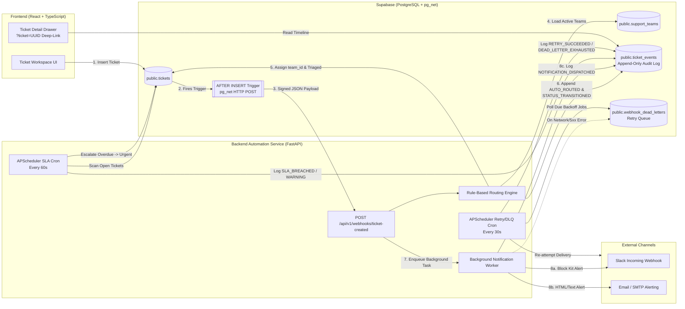
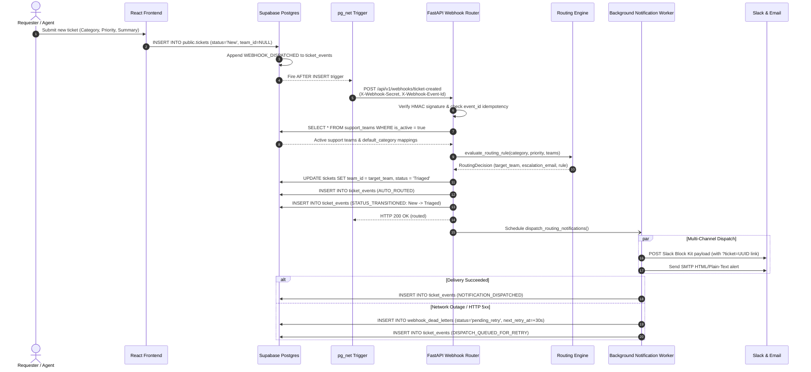
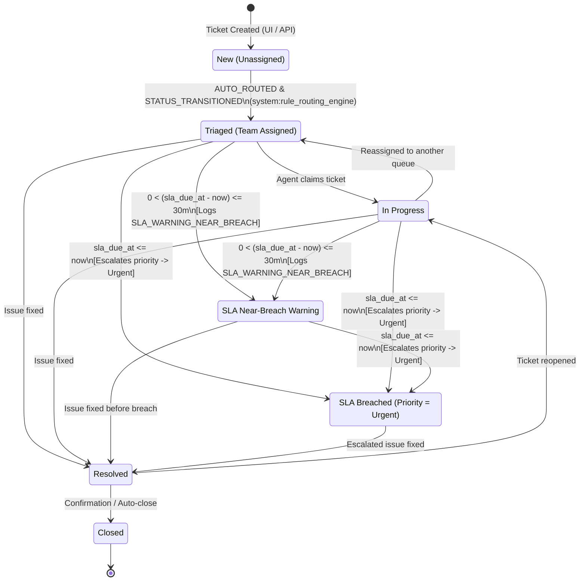
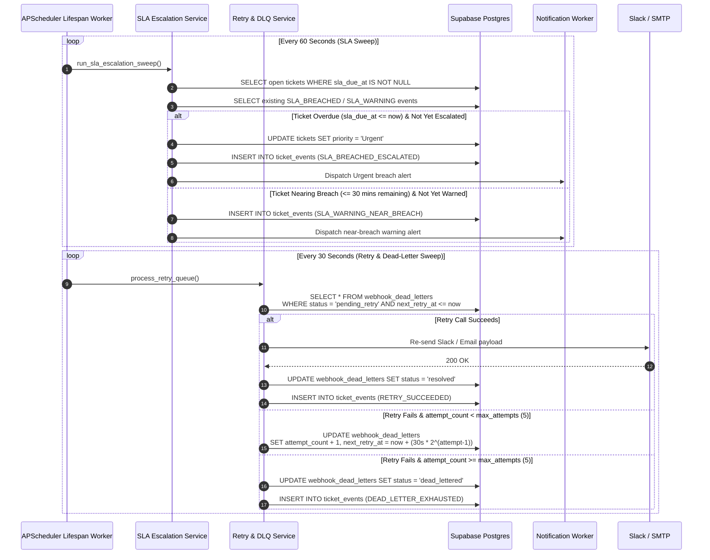

# SupportFlow Event-Driven Automation Architecture

SupportFlow decouples user-facing ticket submission from asynchronous backend processing. The React client interacts exclusively with Supabase Postgres for CRUD operations, while PostgreSQL database triggers (`pg_net`), FastAPI background workers, and `APScheduler` cron jobs orchestrate deterministic ticket routing, multi-channel notifications, SLA breach escalation, failure retries, and immutable audit logging.

---

## 1. High-Level System Architecture

---

## 2. Ticket Creation, Routing & Notification Sequence

When a user submits a new ticket, PostgreSQL fires an `AFTER INSERT` trigger via `pg_net` to FastAPI. FastAPI verifies the HMAC webhook signature, enforces idempotency, evaluates category and impact rules, updates the ticket (`UPDATE` only—preventing trigger recursion), appends immutable audit records, and dispatches Slack and Email alerts in a non-blocking background task.

### Deterministic Routing Matrix

| `ticket_category` Enum | Priority Condition | Assigned Support Team | Escalation Applied |
| :--- | :--- | :--- | :--- |
| `Hardware` | Any | **IT Field Support** | No |
| `Software` | `Low` / `Medium` | **Application Support** | No |
| `Software` | `High` / `Urgent` | **Cloud & DevOps** | Yes (High-impact override) |
| `Network` | Any | **Network Operations** | No |
| `Access & IAM` | Any | **Identity & Security** | No |
| `Database & Cloud` | Any | **Cloud & DevOps** | No |
| `Other` / Unclassified | Any | **General Triage Desk** | Fallback |

---

## 3. Ticket Lifecycle & SLA State Machine

Tickets progress through deterministic lifecycle states driven by automated routing, agent resolution, and scheduled SLA enforcement. Terminal states (`Resolved`, `Closed`) are excluded from SLA escalation sweeps.

---

## 4. Scheduled SLA Breach Escalation & Retry Queue Sequence

Two `APScheduler` background jobs run inside the FastAPI application lifespan:
1. **SLA Breach Worker (`60s` interval):** Detects tickets approaching their `sla_due_at` deadline (`<= 30m`) or past due (`<= now`), escalates overdue tickets to `Urgent`, deduplicates alerts against `ticket_events`, and notifies on-call teams.
2. **Dead-Letter Retry Worker (`30s` interval):** Polls `webhook_dead_letters` for failed Slack/Email dispatches whose exponential backoff timer (`30s → 60s → 120s → 240s → 480s`) has elapsed.

---

## 5. Immutable Audit Log Guarantee

Every automated state transition is persisted to `public.ticket_events` via `backend/app/services/audit.py`. A PostgreSQL `BEFORE UPDATE OR DELETE` trigger (`trg_ticket_events_immutable`) enforces strict append-only compliance at the database layer.

| Event Type | Automated Actor | Triggering Condition |
| :--- | :--- | :--- |
| `WEBHOOK_DISPATCHED` | `postgres:pg_net_trigger` | New ticket inserted into `public.tickets` |
| `AUTO_ROUTED` | `system:rule_routing_engine` | Ticket matched to a support team or fallback desk |
| `STATUS_TRANSITIONED` | `system:rule_routing_engine` | Automated status move (`New` → `Triaged`) |
| `NOTIFICATION_DISPATCHED` | `system:notification_worker` | Team alert sent (or dry-run logged) via Slack/Email |
| `SLA_WARNING_NEAR_BREACH` | `system:sla_escalation_worker` | Open ticket enters the 30-minute pre-breach window |
| `SLA_BREACHED_ESCALATED` | `system:sla_escalation_worker` | Overdue ticket automatically escalated to `Urgent` |
| `DISPATCH_QUEUED_FOR_RETRY` | `system:retry_dlq_worker` | Failed external call persisted to `webhook_dead_letters` |
| `RETRY_SUCCEEDED` | `system:retry_dlq_worker` | Previously failed dispatch recovered on backoff retry |
| `DEAD_LETTER_EXHAUSTED` | `system:retry_dlq_worker` | Dispatch reached `max_attempts` (5) and moved to `dead_lettered` |